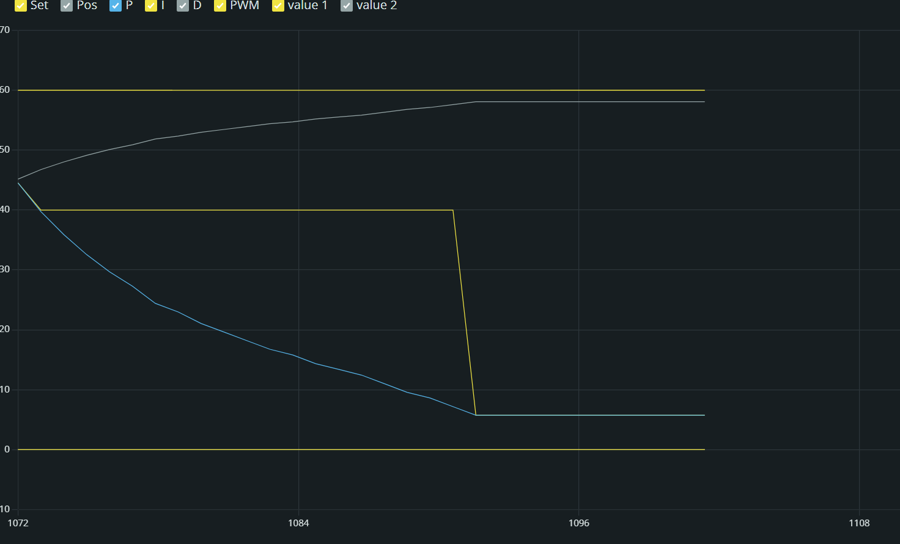
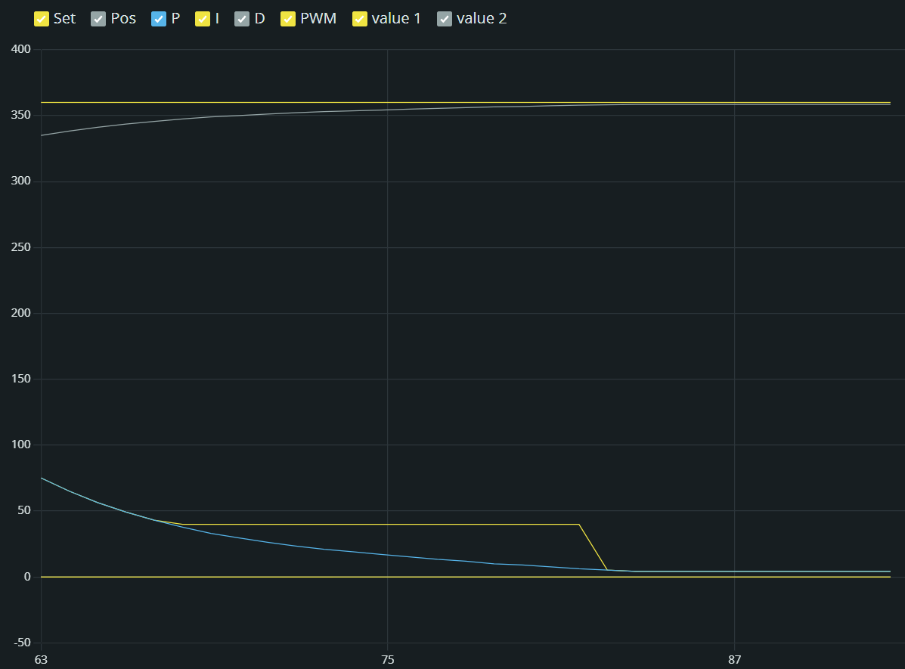

# DC Motor PID Position Control (Arduino Uno + L298N + GM25-370 Encoder Motor)

Closed-loop **position control** of a 12 V geared DC motor with a Hall-effect quadrature encoder.
You type the PID gains (Kp, Ki, Kd) and a target angle into the Serial Monitor. The motor turns to
that angle, the response is plotted live, and once the shaft settles the motor stops and the
program prints a step-response report (rise time, settling time, overshoot, steady-state error).

Every cycle starts by **homing the shaft back to the zero reference**, so every test starts from 0°.

---

## Contents

1. [Parts list](#1-parts-list)
2. [Software and libraries](#2-software-and-libraries)
3. [Wiring / pin connections](#3-wiring--pin-connections)
4. [Upload the code](#4-upload-the-code)
5. [Run a test](#5-run-a-test)
6. [Plot the full graph with Python](#6-plot-the-full-graph-with-python)
7. [Tuning guide](#7-tuning-guide)
8. [Settings you can change](#8-settings-you-can-change)
9. [Troubleshooting](#9-troubleshooting)
10. [How it works](#10-how-it-works)
11. [Files in this repo](#11-files-in-this-repo)

---

## 1. Parts list

| # | Part | Notes |
|---|------|-------|
| 1 | Arduino Uno (or clone with CH340 USB chip) | Any Uno-compatible board |
| 1 | L298N motor driver module | The common red/black board with a heatsink |
| 1 | GM25-370CA-12560-47 DC gear motor **with Hall encoder** | 12 V, 47:1 gearbox, 75 rpm no-load, 12 PPR encoder |
| 1 | 12 V DC power supply, **at least 1 A** | Wall adapter or bench supply (motor stall current ≈ 0.46 A) |
| 1 | USB A-to-B cable | Arduino ↔ PC |
| ~8 | Jumper wires (male-female / male-male) | |
| 1 | Small screwdriver | For the L298N screw terminals |
| 1 | Piece of tape or marker | To mark the shaft's zero position (optional) |

> If you have a different gear ratio or encoder, change `GEAR` and `ENC_PPR` in the code
> (see [Settings](#8-settings-you-can-change)).

---

## 2. Software and libraries

### Arduino side
- **Arduino IDE 2.x** – download from <https://www.arduino.cc/en/software>
- **No extra libraries needed.** The sketch only uses built-in Arduino functions
  (`attachInterrupt`, `analogWrite`, `Serial`).
- If you use an Uno **clone** (CH340 chip) and it doesn't show up as a COM port, install the
  CH340 driver: <https://www.wch-ic.com/downloads/CH341SER_EXE.html>

### PC side (optional, for full-quality graphs)
- **Python 3.8+** – <https://www.python.org/downloads/> (tick *"Add Python to PATH"* during install)
- Python libraries:

```bash
pip install pyserial matplotlib
```

---

## 3. Wiring / pin connections

> ⚠️ **Do all wiring with the 12 V supply switched OFF and USB unplugged.**
> ⚠️ **Never connect 12 V to any encoder pin or to the Arduino** – it will destroy them.

### 3.1 Identify the motor's encoder wires

The encoder board on the back of the motor has a 6-wire cable. The pads on the board are usually
labelled like this (check **your** board's labels – wire colours differ between sellers):

| Label on encoder board | Meaning |
|---|---|
| `M1` / `M+` | Motor power + (goes to the L298N, **not** the Arduino) |
| `M2` / `M-` | Motor power − (goes to the L298N, **not** the Arduino) |
| `VCC` / `3.3-5V` | Encoder power (5 V from Arduino) |
| `GND` | Encoder ground |
| `C1` / `A` | Encoder channel A |
| `C2` / `B` | Encoder channel B |

### 3.2 Connection table

**Arduino Uno ↔ L298N**

| Arduino pin | L298N pin | Purpose |
|---|---|---|
| **D6** | **IN1** | PWM – forward |
| **D5** | **IN2** | PWM – reverse |
| **GND** | **GND** | Common ground (**required**) |
| — | **ENA** | Leave the **jumper cap ON** (motor A always enabled) |

**Power ↔ L298N**

| From | L298N terminal | Notes |
|---|---|---|
| 12 V supply **+** | **+12V** (sometimes labelled `VS` / `VCC`) | |
| 12 V supply **−** | **GND** | Same GND terminal the Arduino GND goes to |
| — | **+5V** | Leave **unconnected** (Arduino is powered by USB). Keep the 5 V regulator jumper on. |

**Motor ↔ L298N**

| Motor wire | L298N terminal |
|---|---|
| `M1` / `M+` | **OUT1** |
| `M2` / `M-` | **OUT2** |

**Encoder ↔ Arduino**

| Encoder wire | Arduino pin | Purpose |
|---|---|---|
| `VCC` | **5V** | Encoder power |
| `GND` | **GND** | Encoder ground |
| `C1` / `A` | **D2** | Channel A (interrupt 0) |
| `C2` / `B` | **D3** | Channel B (interrupt 1) |

### 3.3 Wiring diagram

```
                    +----------------------+
  12V PSU (+) ----->| +12V                 |
  12V PSU (-) --+-->| GND           OUT1   |------> Motor M1 (+)
                |   | +5V  (unused)  OUT2  |------> Motor M2 (-)
                |   |                      |
                |   | ENA [jumper ON]      |
                |   | IN1  IN2             |
                |   +--+----+--------------+
                |      |    |      L298N
                |      |    |
   +------------|------|----|-------------+
   |   Arduino  |      |    |             |
   |           GND    D6   D5             |
   |                                      |
   |   5V ---------------------> Encoder VCC
   |   GND --------------------> Encoder GND
   |   D2  <-------------------- Encoder C1 (A)
   |   D3  <-------------------- Encoder C2 (B)
   |                                      |
   |   USB  <------> PC                   |
   +--------------------------------------+
```

### 3.4 Wiring checklist (tick each before powering on)

- [ ] Arduino GND, L298N GND and 12 V supply (−) are all connected together
- [ ] ENA jumper cap is ON
- [ ] IN1 → D6, IN2 → D5
- [ ] Motor wires go to OUT1/OUT2 (not to the Arduino)
- [ ] Encoder VCC → 5V (**not** 12 V), GND → GND
- [ ] Encoder A → D2, Encoder B → D3
- [ ] Nothing is attached to the motor shaft that can hit something when it spins

---

## 4. Upload the code

1. Download / clone this repository.
   ```bash
   git clone https://github.com/IB-007/arduino-pid-motor-position-control.git
   cd arduino-pid-motor-position-control
   ```
2. Open **Arduino IDE** → **File → Open…** → select `motor_pid/motor_pid.ino`.
   (The sketch must stay inside a folder with the same name, `motor_pid`.)
3. Plug the Arduino into the PC with the USB cable.
4. **Tools → Board → Arduino AVR Boards → Arduino Uno**
5. **Tools → Port →** pick the COM port that appeared (e.g. `COM8`, on Linux `/dev/ttyUSB0`,
   on macOS `/dev/cu.usbserial-…`).
6. Click **Upload** (→ arrow button, or **Ctrl+U**). Wait for **"Done uploading."**
7. Switch **ON** the 12 V supply.

---

## 5. Run a test

### 5.1 Open the Serial Monitor

1. **Tools → Serial Monitor** (or the 🔍 icon top-right). It opens at the bottom of the IDE.
2. In the two drop-downs at the right of the monitor set:
   - **New Line**
   - **115200 baud**
3. Press the **RESET** button on the Arduino. You should see:
   ```
   --- Homing to zero reference from 0.00 deg ---
   At zero reference.

   --- New move ---
   Enter Kp (e.g. 3)
   ```

> **Zero reference** = wherever the shaft is when the Arduino powers on / resets.
> Put a tape mark on the shaft and line it up before pressing reset if you want a repeatable zero.

### 5.2 Enter the values

Type into the **message box at the top of the Serial Monitor** and press **Enter** after each:

| Prompt | Example | Meaning |
|---|---|---|
| `Enter Kp` | `3` | Proportional gain |
| `Enter Ki` | `0` | Integral gain |
| `Enter Kd` | `0` | Derivative gain |
| `Enter target angle in deg` | `60` | Target, measured from zero. Negative = reverse. `360` = one full turn |

After each value the Arduino echoes `got <value>` so you can confirm it was received.

### 5.3 Watch it move

- The motor turns to the target and streams one line every 20 ms:
  ```
  Set:60.00,Pos:14.04,P:137.87,I:0.00,D:0.00,PWM:137.87
  ```
- **Live graph:** close the Serial Monitor and open **Tools → Serial Plotter** (115200 baud), or
  open both at once in IDE 2. Untick the series you don't need in the legend
  (e.g. keep only **Set** and **Pos**). Ignore `value 1` / `value 2` – those come from text lines.
- Send **`x`** at any time to abort the move and stop the motor.

**Example – Serial Plotter, Kp 3, Ki 0, Kd 0, target 60°:**
Position (grey) curves up to ~58° and stops inside the ±2° band. P (blue) shrinks as the error
shrinks; PWM (yellow) is held at the 40 minimum (deadband compensation) until the shaft is in the band.



**Example – Kp 3, Ki 0, Kd 0, target 360°:** same behaviour on a full turn – no overshoot,
settles at ~358°.



> The IDE 2 plotter keeps only the last ~50 points, so the start of the move scrolls off.
> Use `plot_pid.py` ([section 6](#6-plot-the-full-graph-with-python)) to capture the whole move.

### 5.4 Read the report

When the shaft stays within ±2° of the target for 1 s, the motor stops and prints:

```
===== Settled - motor stopped =====
Kp = 3.00
Ki = 0.00
Kd = 0.00
Target (deg) = 60.00
Rise time 10-90% (s) = 0.44
Settling time (s) = 0.72
Peak (deg) = 58.24
Overshoot (%) = 0.00
Final avg position (deg) = 58.09
Steady-state error (deg) = 1.91
Final avg PWM (-255..255) = 5.73
===================================
```

The motor then homes back to 0° and asks for the next set of values.

---

## 6. Plot the full graph with Python

The IDE 2 Serial Plotter only shows the last ~50 points (≈ 1 s), and the Serial Monitor only
copies visible lines. `plot_pid.py` records a whole move and draws a proper graph.

### Option A – record directly (recommended)

1. **Close** the Serial Monitor and Serial Plotter in the Arduino IDE (only one program can use
   the COM port).
2. Open a terminal (Command Prompt / PowerShell / Terminal) in the repo folder:
   ```bash
   cd path/to/repo
   python plot_pid.py COM8
   ```
   Replace `COM8` with your port (`/dev/ttyUSB0` on Linux, `/dev/cu.usbserial-…` on macOS).
3. The Arduino resets and homes. Type the answers in the terminal: `3` ↵ `0` ↵ `0` ↵ `60` ↵
4. After the report, a graph window opens:
   - **Top:** Setpoint and Position vs time (s)
   - **Bottom:** P, I, D terms and total PWM
5. Files written in the repo folder:
   - `data.txt` – raw serial log
   - `data.csv` – the data (open in Excel)
   - `plot.png` – the graph image
6. Rename `plot.png` / `data.csv` if you want to keep them – the next run overwrites them.
   Run the command again for the next test.

### Option B – plot an existing log

Put the `Set:...` lines in a file called `data.txt` in the repo folder, then:

```bash
python plot_pid.py
```

---

## 7. Tuning guide

Run these one after another (target in degrees) to see what each gain does:

| Run | Kp | Ki | Kd | Target | What you should see |
|---|---|---|---|---|---|
| 1 | 3 | 0 | 0 | 60 | Smooth exponential-like rise, no overshoot, stops ~2° short (steady-state error) |
| 2 | 1.5 | 0 | 0 | 160 | Slower, cleaner exponential curve (good for reports) |
| 3 | 8 | 0 | 0 | 30 | Fast rise, **overshoot**, small oscillation (underdamped) |
| 4 | 8 | 0 | 0.1 | 30 | Same, but **D damps** the overshoot |
| 5 | 3 | 3 | 0 | 60 | **I removes** the steady-state error, may overshoot slightly |
| 6 | 3 | 2 | 0.05 | 180 | Good all-round starting point |

**Rules of thumb**

| Symptom | Fix |
|---|---|
| Too slow to reach target | Increase **Kp** |
| Overshoots the target | Increase **Kd**, or decrease Kp / Ki |
| Stops a few degrees short | Increase **Ki** (or `MIN_PWM`, see below) |
| Buzzes / hunts around the target | Decrease **Ki**, or set `TOL_DEG = 3` |
| PWM line very noisy | Decrease **Kd** |

**Why the graph is a straight line for big targets:** if `Kp × target > 255` the output is
clamped at full speed, so position rises in a straight line. Keep `Kp × target < 255` to see the
classic exponential / overshoot curves.

---

## 8. Settings you can change

All at the top of `motor_pid/motor_pid.ino`. Re-upload after changing.

| Constant | Default | What it does |
|---|---|---|
| `ENC_A`, `ENC_B` | 2, 3 | Encoder pins (must be the Uno's interrupt pins 2 and 3) |
| `IN1`, `IN2` | 6, 5 | L298N input pins (must be PWM pins) |
| `DIR` | -1 | Motor direction. If the motor **runs away** from the target, flip to `1` |
| `ENC_PPR` | 12 | Encoder pulses per motor revolution (3 or 12 on this motor) |
| `GEAR` | 47 | Gearbox ratio |
| `TS_MS` | 20 | Control loop period in ms (also update `TS` in `plot_pid.py`) |
| `TOL_DEG` | 2 | Settled when within ± this many degrees |
| `HOLD_MS` | 1000 | …and stays there this long (ms) |
| `TIMEOUT_MS` | 30000 | Gives up and stops after this long |
| `MIN_PWM` | 40 | Smallest PWM that turns the motor (deadband compensation) |
| `HOME_KP/KI/KD` | 3 / 2 / 0.05 | Fixed gains used for homing |

**How to find your `MIN_PWM`:** run `3, 0, 0, 90`. If it stops well short of 90, raise `MIN_PWM`
by 5. If it overshoots back and forth, lower it by 5.

**How to check `ENC_PPR`:** command a 360° move and mark the shaft. If it turns about 4 turns
instead of 1, change `ENC_PPR` from 3 to 12 (or the other way round if it turns ¼ turn).

---

## 9. Troubleshooting

| Message / symptom | Cause | Fix |
|---|---|---|
| `RUNAWAY - motor stopped` or position keeps growing the wrong way | Motor and encoder directions disagree | Change `DIR` (1 ↔ -1), **or** swap encoder A/B wires. Press RESET afterwards |
| `STALL - PWM high but shaft not moving` | Motor gets no power | Check IN1→D6, IN2→D5, ENA jumper, 12 V supply ON, motor wires in OUT1/OUT2 |
| Motor only moves one direction | IN2 (or IN1) wire loose | Re-seat the D5→IN2 / D6→IN1 wires |
| `Did NOT settle within 30 s` | Gains too low / too high | See [Tuning guide](#7-tuning-guide) |
| Position doesn't change when you turn the shaft by hand | Encoder not powered / wrong pins | Encoder VCC→5V, GND→GND, A→D2, B→D3 |
| Prompts appear twice / Arduino restarts when motor starts | Supply voltage dips and resets the Uno | Make sure grounds are shared, power Uno from USB, use a ≥1 A 12 V supply |
| Garbage characters in Serial Monitor | Wrong baud rate | Set **115200** |
| Typed value not accepted | Wrong line ending | Set **New Line** |
| No COM port in Tools → Port | Driver missing / charge-only cable | Install CH340 driver, try another USB cable |
| `could not open port` in Python | Port in use | Close Serial Monitor / Plotter in the IDE |
| Graph in Serial Plotter cuts off the start | Plotter only keeps ~50 points | Use `plot_pid.py` (section 6) |
| Homing ends a degree or two off zero | Normal – within ±2° tolerance and gearbox backlash | Lower `TOL_DEG` if you need tighter |

---

## 10. How it works

```
 Power-on / RESET  ->  position counter = 0  (zero reference)
        |
        v
 +-> HOME to 0 deg (fixed gains, not plotted)
 |      |
 |      v
 |   Ask Kp, Ki, Kd, target
 |      |
 |      v
 |   Every 20 ms:  error = target - position
 |                 P = Kp * error
 |                 I = Ki * integral(error)      (frozen while output is saturated)
 |                 D = -Kd * velocity            (on measurement, avoids kick)
 |                 PWM = P + I + D  -> clamp to +-255
 |                 if |error| > tolerance and |PWM| too small -> boost to MIN_PWM
 |                                               (ramps up if the shaft is stuck)
 |                 print Set, Pos, P, I, D, PWM
 |      |
 |      v
 |   Within +-2 deg for 1 s?  -> stop motor, print report
 |      |
 +------+
```

- **Encoder:** quadrature decoding on both edges of A and B →
  `12 PPR × 4 × 47 = 2256 counts per output revolution` (≈ 0.16° per count).
- **Driver:** the L298N's ENA is held high by its jumper; PWM goes on IN1 for forward and IN2 for
  reverse.
- **Safety stops:** abort (`x`), 30 s timeout, runaway detection (moved > 1 turn the wrong way),
  stall detection (PWM > 150 for 1 s with no movement).

---

## 11. Files in this repo

| File | Description |
|---|---|
| `motor_pid/motor_pid.ino` | Arduino sketch (upload this) |
| `plot_pid.py` | Python script: records a move over serial and plots / saves it |
| `GM25-370CA.PDF`, `GM25-370CA (1).pdf` | Motor datasheets |
| `images/` | Example Serial Plotter screenshots (Kp 3, Ki 0, Kd 0 → 360° and 60°) |
| `README.md` | This file |

Generated when you run `plot_pid.py` (not committed): `data.txt`, `data.csv`, `plot.png`.
